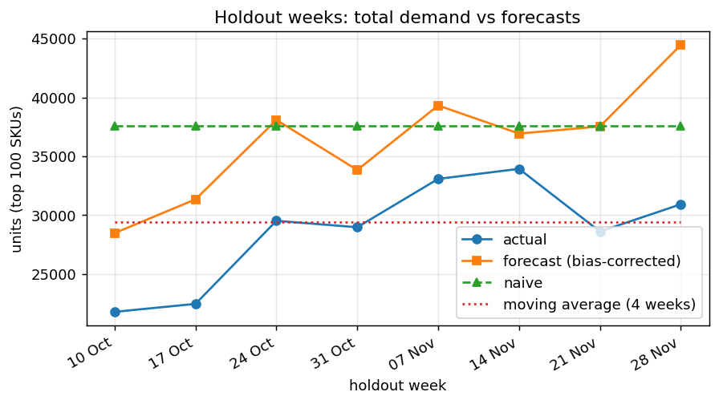
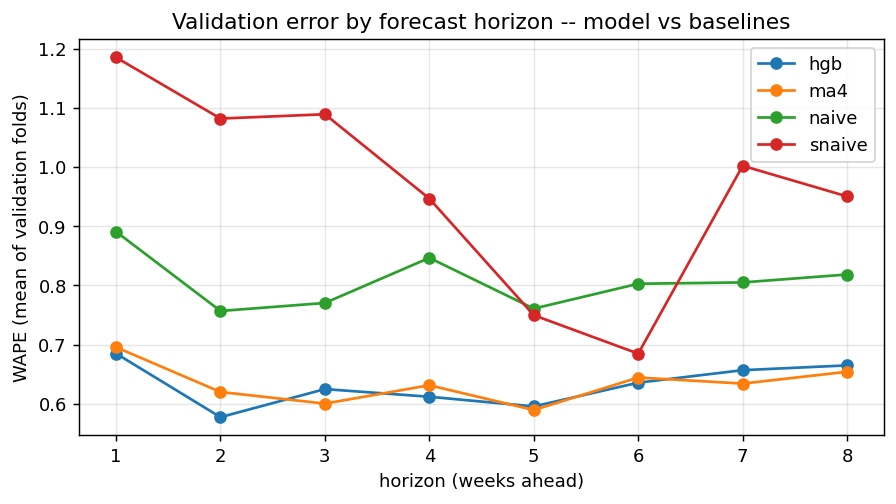
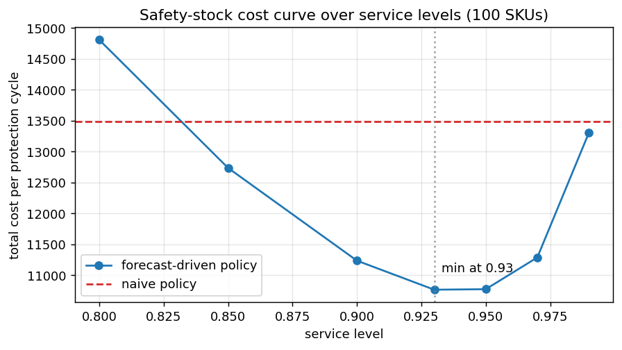

# DemandPilot - SKU Demand Forecasting & Inventory Planning

**Python | SQL | DuckDB | scikit-learn | time-series validation | inventory simulation | FastAPI**

Forecast eight weeks of SKU demand and translate forecast uncertainty into an
illustrative safety-stock policy. The project uses real historical transactions
from [UCI Online Retail II](https://archive.ics.uci.edu/dataset/502/online+retail+ii).
Inventory costs and policy savings are simulated, not realized business outcomes.

## Corrected evaluation results

The evaluation now uses one fixed origin per eight-week window. The SKU cohort is
frozen before the earliest validation period. These results supersede the earlier
56.6% WAPE and 34.4% simulated-savings figures, which came from the old protocol.

| Model | Holdout WAPE | Macro MASE | Signed bias |
|---|---:|---:|---:|
| HGB with validation-fold bias correction | **0.690** | 0.978 | +0.265 |
| HGB, raw | 0.730 | 1.033 | +0.343 |
| Four-week moving average | **0.609** | 0.849 | +0.026 |
| Last observed week | 0.959 | 1.334 | +0.310 |
| Seasonal naive | 1.006 | 1.278 | +0.581 |

**The moving-average baseline wins on the untouched holdout.** HGB improves on the
last-week and seasonal baselines, but ML is not established as the best deployment
choice. The holdout was not used to retune the model or select new parameters.
Validation-calibrated 90% prediction bands cover **93.9%** of holdout outcomes.
The corrected HGB beats the last-week baseline on **53% of the 99 SKUs with nonzero
holdout demand**; one zero-demand SKU has undefined individual WAPE and remains in
pooled error metrics.

[Full evaluation report](reports/forecast_report.md) | [Saved metrics](reports/backtest.csv)




## Data and SQL warehouse

- **1,067,371** source/interim transaction lines; returns remain auditable in the interim data.
- Warehouse demand uses positive quantities, positive prices and non-cancellation lines.
- Partial first and last source weeks are excluded. The remaining regular grid has
  **104 weeks, 7 December 2009 to 28 November 2011**, with 102 observed transaction weeks.
- The descriptive catalogue contains **4,713 codes**. DuckDB SQL aggregates weekly
  units, distinct orders and revenue, and computes revenue-based ABC classes using
  window functions.
- **100 SKUs** are selected by units using data **strictly before 25 April 2011**,
  with at least 52 active weeks in that training window. They cover **20.4% of revenue
  in the selection window**, not a retrospectively selected full-period share.

The full-period ABC catalogue is descriptive. It is not used to choose the modeling
cohort. Missing internal weeks are assumed zero sales; this does not prove store
closure, source completeness or product availability.

## Forecasting and temporal controls

1. Define origin as the **last observed week**. Demand/price/order features use
   observations through that week only; horizon `h=1..8` identifies a future target.
   `units_lag1` is the last observed demand, the lag for the first forecast target.
2. Freeze SKU eligibility and ranking before all validation windows.
3. Evaluate three expanding-training folds, each forecasting all eight weeks from
   one origin. Fit only pairs whose target week is on or before that origin.
4. Fit the evaluation model before the final holdout. Score exactly **800 unique
   SKU/week predictions** without updating features using holdout observations.
5. Estimate bias factors and residual bands on validation folds only.
6. After holdout scoring, refit the frozen HGB configuration on all observed targets
   for the example API. This serving refit has not received a new out-of-sample test.

The HGB configuration is 300 iterations, learning rate 0.06, minimum leaf size 20
and L2 penalty 1.0. There are 20 origin features plus the horizon feature. Unknown
prices in no-sale weeks remain missing; HGB supports them, and zero-demand targets
are retained. Zero-demand SKUs are not discarded from pooled evaluation.

## Inventory decision layer

For a six-week protection period (four-week lead time plus two-week review),
**20,000 Monte Carlo draws per SKU** resample validation-fold relative residuals.
Both policies are evaluated on the same modeled demand distribution.

| Policy | Safety stock, units | Simulated cost per cycle | Compared with naive |
|---|---:|---:|---:|
| Two weeks of forecast cover as safety stock | 37,248 | 13,489 | Baseline |
| Forecast-driven, target cycle service level 0.95 | 71,075 | 10,775 | **20.1% lower** |
| Per-SKU grid cost minimum | 62,769 | 10,767 | **20.2% lower** |

Assumed holding cost is 0.02 per unit-week; stockout cost is 2.0 per unit. Costs
are illustrative units, not audited currency savings. Mean naive per-SKU cycle
service level is approximately 83%. This is cycle service probability, not fill rate.

Residuals are clipped to [-1, 3] and sampled independently across forecast weeks.
The model therefore truncates extreme tails and omits serial dependence. The cost
improvement measures a safety-stock rule under these assumptions; it does **not**
prove the HGB forecast saves more than moving-average forecasts on real inventory.



## Run locally

Python 3.12 is the tested interpreter. From the repository root:

```bash
python -m venv .venv
# Windows PowerShell: .venv\Scripts\Activate.ps1
# macOS/Linux: source .venv/bin/activate
pip install -r requirements.txt
python -m src.pipeline
python -m pytest -q
uvicorn src.api:app --host 127.0.0.1 --port 8000
```

The first pipeline run downloads the source workbook. Data and model binaries
are gitignored; reports and evaluation evidence are committed. A clean clone can
run the full test suite without downloading the source or having model artifacts:
API contracts use deterministic fixtures, while evidence tests check committed results.
GitHub Actions runs the same suite on pushes and pull requests.

Individual stages remain available: `src.data`, `src.warehouse`, `src.features`,
`src.backtest`, `src.train`, `src.inventory` and `src.evaluate`.
Restart the API after regenerating cached artifacts.

## Example API

- `/health`: model readiness, training metadata and evaluation metrics.
- `/skus`: modeled SKU list.
- `/forecast/85123A`: eight weekly predictions and validation-calibrated bands.
- `/inventory/85123A`: the latest simulated safety-stock policy.

The default origin is the latest stored week. Requests for origins before the
serving model's training cutoff return **422**, preventing historical forecasts
from masquerading as out-of-sample predictions. Unknown SKUs/origins return 404;
missing artifacts return 503. The API is an example local service, not a claimed
production deployment or live feature store.

## Evidence and limitations

- [Temporal selection and split regressions](tests/test_temporal_contracts.py)
- [Always-on API contracts](tests/test_api.py)
- [Prediction uniqueness, cutoff and metric reconciliation](tests/test_evidence.py)
- [Reproduction and review record](docs/VERIFICATION.md)
- [Machine-readable execution checks](reports/verification.json)

Performance covers one historical cohort and holdout. Real replenishment work
needs authoritative product IDs, stock availability, actual lead times, correlated
demand scenarios, inventory simulation on unseen realized demand and monitoring.
A zero transaction count cannot distinguish no demand from unavailable stock.
