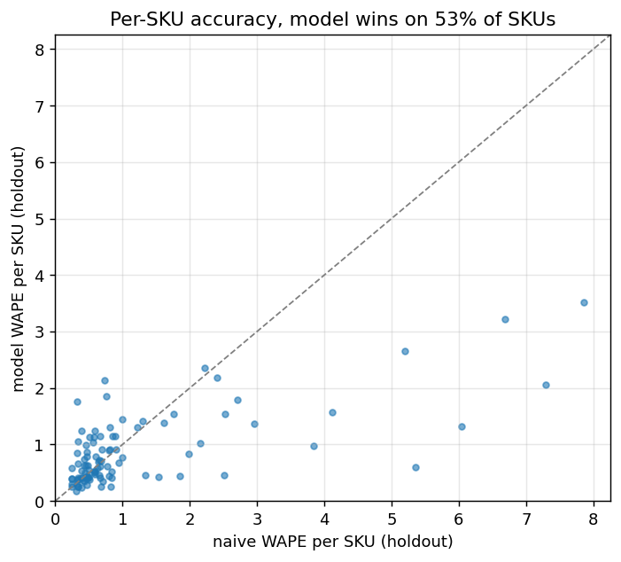

# DemandPilot -- forecast and inventory evaluation

Generated by `python -m src.evaluate`. Data: UCI Online Retail II,
2009-12-07 to 2011-11-28 (104 weeks).
The 100 SKUs and their 20.4% revenue share
are selected using data strictly before 2011-04-25.
Model: HistGradientBoosting,
direct multi-step, 8-week horizon, 20 leakage-safe features.
Artifact: `demand_hgb_v1.joblib` (version v1).

## Holdout (last 8 weeks, excluded from evaluation-model fitting and calibration)

Each validation fold and the holdout forecast all eight target weeks from one
fixed origin. Training targets end on or before that origin; no evaluation-window
observations update the features. The holdout has 800 unique SKU/week
predictions. The serving model is refitted on all observed targets only after
holdout scoring; the API rejects origins before its training cutoff.

| model | wape | mase_macro | bias |
|---|---|---|---|
| hgb_bias_corrected | 0.690 | 0.978 | 0.265 |
| hgb | 0.730 | 1.033 | 0.343 |
| ma4 | 0.609 | 0.849 | 0.026 |
| naive | 0.959 | 1.334 | 0.310 |
| snaive | 1.006 | 1.278 | 0.581 |

WAPE = volume-weighted absolute error; MASE uses each SKU's seasonal-naive training MAE.
The corrected forecast beats the last-week baseline on 53% of SKUs.
This per-SKU comparison excludes 1
SKU(s) with zero holdout demand, whose WAPE is undefined; pooled metrics retain them.
Bias correction changes signed bias from 0.343 to 0.265
and WAPE from 0.730 to 0.690.
Validation-calibrated 90% prediction bands cover 93.9% of holdout outcomes;
this empirical coverage is reported rather than assuming nominal calibration.

## Rolling-origin validation folds (WAPE, all horizons pooled)

| model | fold0 | fold1 | fold2 |
|---|---|---|---|
| hgb | 0.655 | 0.570 | 0.635 |
| ma4 | 0.644 | 0.600 | 0.625 |
| naive | 0.718 | 0.723 | 0.930 |
| snaive | 0.899 | 0.895 | 1.001 |

Folds where at least one baseline has lower WAPE than raw HGB:
fold0, fold2. Compare all models in the table;
no universal model superiority is assumed. The untouched holdout is a test, not a
model-tuning set: compare its moving-average baseline with HGB before considering
deployment. These results do not justify preferring ML in every setting.

## Holdout: actual vs forecast

## Inventory policy (lead time 4w +
review 2w = 6-week protection window)

Monte Carlo (20,000 draws/SKU) over validation-fold
residuals; holding cost 0.02/unit-week vs
stockout cost 2.0/unit. The naive policy
achieves a 83% mean per-SKU cycle service level:

| policy | safety stock (units) | cost per cycle | vs naive |
|---|---|---|---|
| naive 2-weeks-of-cover | 37248 | 13489 | - |
| forecast-driven @ target SL 0.95 | 71075 | 10775 | 20.1% cheaper |
| forecast-driven @ per-SKU optimum (min cost at SL 0.93) | 62769 | 10767 | 20.2% cheaper |

The empirical grid minimum is at service level 0.93. For this simplified
linear safety-stock holding cost plus expected shortage objective, the continuous
optimum is F(Q) = 1 - holding_cost_per_unit_week * protection / stockout_cost_per_unit
= 0.940,
when interior. This is a simulation consistency check, not observed savings.

## Limitations

- Metrics refer to one historical holdout and a cohort frozen before validation.
  They do not establish future accuracy or causal savings.
- Partial first/last source weeks and nonpositive-price lines are excluded from the
  warehouse. Unobserved internal weeks are assumed zero; source completeness is not proven.
- The Monte Carlo treats horizon residuals as independent across weeks; demand
  dependence is unmodeled. Positive correlation may increase inventory risk, but
  no universal lower-bound guarantee is claimed.
- Relative residuals are clipped to [-1, 3]; extreme demand tails are truncated.
  Costs and service levels are simulated on this bounded residual model, not
  independently validated inventory outcomes.
- A real catalogue requires an authoritative product master and stock-availability
  history; high unit volume is not proof that an item is a valid retail product.
